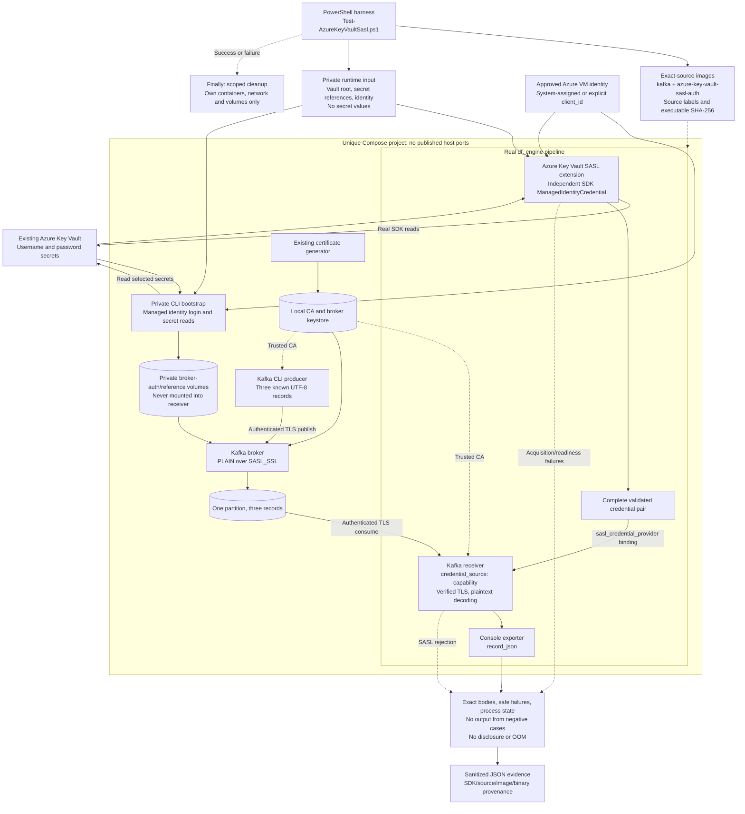

# Azure Key Vault SASL credentials: Kafka receiver E2E

This development-only harness validates **initial credential acquisition** by
the real `urn:otel:extension:azure_key_vault_sasl_auth` extension and Kafka
receiver against the existing [SASL/TLS example](../sasl-tls/README.md)'s broker.
It uses the published Secrets `1.1.0-beta.1`, Core `1.2.0-beta.1`, and Identity
`1.1.0-beta.1` registry packages, not a Git-sourced SDK or a mock provider.
These are released preview packages, not stable releases or FIPS approval.

The [validation report](VALIDATION.md) records the completed five-case run,
its exact source/image provenance, and what has not been rerun on this branch.

## Test workflow



Both secrets must be acquired before readiness; a partial pair never enables
the receiver. Each case uses a fresh receiver container and consumer group.
The CLI provisions only the disposable broker. The receiver independently
uses the SDK and cannot mount the broker's credential/reference volumes.
No inline/file fallback, polling, rotation, or receiver reconnection is tested.

## Prerequisites and private input

Use an explicitly approved Linux/amd64 Azure VM with Docker and an existing
managed identity. That identity needs network access and read permission for
both selected test secrets: **Key Vault Secrets User** on an RBAC vault, or
**Secrets Get** on a legacy access-policy vault. The harness does not create
Azure resources or change identities, permissions, firewalls, or secret values.
Do not use production credentials or alter a vault to make the fixture pass.

Building requires Git, Docker with Compose v2/buildx, and the pinned protobuf
submodule. The build commands below use PowerShell 7; execution can instead
use the containerized driver, without installing PowerShell or Azure CLI on
the VM. Initialize the submodule from the repository root:

```powershell
git submodule update --init proto/opentelemetry-proto
```

Privately create `azure-key-vault-sasl/.local/runtime.json`:

```json
{
  "vault_url": "https://<vault-name>.vault.azure.net",
  "username_secret": { "name": "<username-secret-name>" },
  "password_secret": { "name": "<password-secret-name>" },
  "identity": { "method": "managed_identity" }
}
```

Replace every placeholder and restrict the directory/file to its owner
(`0700`/`0600` on Linux). `.local` is ignored. Never commit actual vault,
subscription, identity, account, or secret identifiers, token caches, or values.
Omitting `client_id` selects the VM's system-assigned identity; add it only
when the owner explicitly selects an existing user-assigned identity.

This harness accepts public Azure vault roots, not `/secrets/...` URLs.
Each reference optionally accepts `"version": "<32-hex-version>"`; otherwise
it reads the latest version at startup. The two reads are not atomic.
Avoid concurrent secret updates, or use explicit independent version pins.

The local broker fixture requires an alphanumeric/underscore username other
than its synthetic admin `plain`, and a password without control characters.
Supported spaces, quotes, and backslashes are preserved. These are **fixture
restrictions**, not restrictions added to the production SASL provider.

## Build exact-source images

This fork-only branch is based on production
`09ffcae624c5e5fa5bc50efb6788ec8b0e0d3697`. Keep that production object and
commit all validation changes before building. The driver requires clean
source, the exact checkout `HEAD`, and matching image labels; do not relabel an
old image to reuse it.

From the repository root:

```powershell
$repo = (git rev-parse --show-toplevel).Trim()
$source = (git rev-parse HEAD).Trim()
$production = '09ffcae624c5e5fa5bc50efb6788ec8b0e0d3697'
$example = Join-Path $repo 'rust' 'otap-dataflow' 'examples' 'kafka' 'azure-key-vault-sasl'
$engine = "otap-akv-e2e-engine:$($source.Substring(0,12))"
$development = "otap-akv-e2e-development:$($source.Substring(0,12))"
$runner = "otap-akv-e2e-runner:$($source.Substring(0,12))"

docker buildx build --load --platform linux/amd64 `
  --build-context "otel-arrow=$repo" `
  --build-arg TARGETPLATFORM=linux/amd64 `
  --build-arg FEATURES=kafka,azure-key-vault-sasl-auth `
  --build-arg 'RUSTFLAGS=-C target-cpu=x86-64' `
  --build-arg CARGO_BUILD_JOBS=1 `
  --label "org.opencontainers.image.revision=$source" `
  -f (Join-Path $example '..' 'Dockerfile.dataflow') `
  -t $engine (Join-Path $repo 'rust' 'otap-dataflow')
if ($LASTEXITCODE) { throw 'Engine build failed.' }

docker buildx build --load --platform linux/amd64 `
  --build-arg "ENGINE_IMAGE=$engine" `
  --label "org.opencontainers.image.revision=$source" `
  --label "org.otel.akv.production-revision=$production" `
  --label 'org.otel.akv.features=kafka,azure-key-vault-sasl-auth' `
  -f (Join-Path $example 'Dockerfile.development') -t $development $example
if ($LASTEXITCODE) { throw 'Development image build failed.' }

docker buildx build --load --platform linux/amd64 `
  --label "org.opencontainers.image.revision=$source" `
  -f (Join-Path $example 'Dockerfile.runner') -t $runner $example
if ($LASTEXITCODE) { throw 'Driver image build failed.' }
```

The shared [`Dockerfile.dataflow`](../Dockerfile.dataflow) performs a locked
release build with the existing default features and portable x86-64 code.
A cold build can take an hour or more. It needs no Azure identity or Key Vault
access and embeds no runtime credentials.
The [Dockerfile-specific exclusions](../Dockerfile.dataflow.dockerignore)
keep `.local`, `.runs`, `.azure`, and Python caches out of the engine context,
even when private inputs already exist.

The development image adds the pinned official Azure CLI to the unchanged
engine executable on compatible Debian userspace. It is not a production image.
The runner supplies PowerShell, Git, and Docker tools. If building elsewhere,
transfer the exact Git checkout and all three images through an approved
channel, verifying their hashes; never transfer a token cache. Keep exported
archives outside the checkout so the clean-source gate still passes.

## Run on the approved VM

From this example's directory in the same committed checkout:

```sh
production=09ffcae624c5e5fa5bc50efb6788ec8b0e0d3697
status=0
bash scripts/Run-Containerized.sh \
  --execution-approved --managed-identity-vm-approved \
  "$production" "$PWD/.local/runtime.json" || status=$?
printf 'AKV_E2E_OPERATOR_EXIT=%s\n' "$status"
(exit "$status")
```

The wrapper uses `sudo -n docker`, the prebuilt exact-source images, and a
30-minute bound. It does not install host tools or change Docker groups.
**Docker socket access is root-equivalent, not a sandbox.** Use only the
trusted driver and an approved VM. The checkout is mounted at the same
absolute path for nested Docker bind mounts; no host home or Azure cache is
mounted. The driver has no network; only the separately scoped bootstrap and
receiver use the VM identity. CLI login is noninteractive, container-local,
and deleted with that container; the SDK does not consume CLI tokens.

If PowerShell 7 is already available on the VM, the direct equivalent is:

```powershell
$source = (git rev-parse HEAD).Trim()
$development = "otap-akv-e2e-development:$($source.Substring(0,12))"
pwsh -NoProfile -File scripts/Test-AzureKeyVaultSasl.ps1 `
  -SourceCommit $source `
  -ProductionCommit '09ffcae624c5e5fa5bc50efb6788ec8b0e0d3697' `
  -RuntimeInput .local/runtime.json `
  -IdentityMode managed_identity -ManagedIdentityVmApproved -ExecutionApproved `
  -SkipBuild -Image $development
```

These flags acknowledge execution approval; they never grant permission to
mutate Azure.
Managed-identity execution is rejected on Windows or without the VM approval.

For explicitly approved local development only, select
`"identity":{"method":"development"}` and `-IdentityMode development` without
the VM flag. The user must first authenticate inside the pinned Azure CLI
container to a separate, dedicated `otap-akv-e2e-login` volume. The driver
selects [`compose.development.yaml`](compose.development.yaml), never initiates
interactive login, and preserves that external volume. Do not mount a general
host `.azure` directory or copy a development cache to the VM.

## Assertions

| Case | Required result |
| --- | --- |
| Valid credentials | Retrieve both secrets; exactly three expected decoded bodies over SASL_SSL |
| Missing username | `username/not_found`, 15 s credentials readiness failure, nonzero exit, zero records |
| Missing password | `password/not_found`, 15 s credentials readiness failure, nonzero exit, zero records |
| 1 ms startup timeout | Exact `credentials/shared` 1 ms readiness failure, nonzero exit, zero records |
| Broker rejection | Explicit SASL authentication rejection and a further no-delivery window |

The actual binding in [`receiver.yaml`](receiver.yaml) is
`capabilities.sasl_credential_provider: credentials`, with
`auth.sasl.credential_source: capability`; credentials are never placed in
the receiver. The fixture disables runtime recovery so startup failures exit
instead of restarting indefinitely.

Missing-reference cases substitute unique absent names without writing to Key
Vault. Password failure retains the valid username reference. Broker rejection
changes only the disposable broker's expected password, never the vault.
The 1 ms acquisition/readiness timers may race: the exact engine readiness gate
is mandatory, but a fabricated SDK timeout event is not.

Each case must end with a stopped receiver. Log capture is repeated after
observing exit to avoid accepting stale logs. The positive case compares all
three console-exported bodies; broker offsets or startup messages cannot pass it.
Receiver and broker scans reject known credential substrings and escaped
forms without retaining raw output. This is not proof against every possible
transformed disclosure.

An optional `authorization_vault_url` may identify an existing, owner-approved
denied vault. It must produce `authorization`, not a 404 or network failure.
Without that private input the case is explicitly `NOT_RUN`, not passed.

## Evidence, bounds, and cleanup

The harness writes ignored `.runs/<unique-project>` artifacts:

- `provenance.json`: exact source/production SHA, registry SDK versions, image
  ID, executable SHA-256, feature flags, identity mode, and CLI version.
- `expected-bodies.json`: the three controlled input bodies.
- Per-case JSON, `results.json`, and `broker-output.json`: safe classifications,
  record counts, final process observations, disclosure/OOM checks.
- `commands.json`: operation names and actual exit codes, never private stdin.
- `summary.json`: expected/passed counts, test and cleanup outcomes, optional
  authorization coverage, and the last observation even on failure.

Keep the actual outer `AKV_E2E_OPERATOR_EXIT` separately. Inner success JSON
cannot prove the wrapper's cleanup succeeded. A run passes only with all five
required cases, matched provenance, no detected disclosure/OOM, verified scoped
cleanup, and outer exit zero. Never publish `.local`, transient rendered
configuration, raw Docker logs, token caches, or private resource details.

Each run has a unique `akv-sasl-*` project with no published ports. Kafka has
1.5 GiB memory and a 512 MiB heap; receiver/helper/certgen have 512 MiB each.
Services use one CPU. Case observation defaults to 90 seconds (30-180 allowed);
Docker calls, builds, stdin, readiness, shutdown, and cleanup have separate bounds.
Provider readiness is 15 seconds except for the intentional 1 ms case.

`finally` removes only this project's containers, network, volumes, and known
generated runtime files, then verifies removal. The outer wrapper also cleans
its driver and project-labeled resources after interruption. Existing stacks,
the private input, reusable images, build cache, and any external development
login volume remain. Never use global prune/reset or stop unrelated containers.
Any cleanup failure makes the run fail; retained private volumes/logs require
trusted, project-scoped recovery.

Offline checks need no identity, secret reads, or live broker:

```powershell
python -B -m unittest discover -s scripts -p test_akv_runtime.py
pwsh -NoProfile -File scripts/Test-CaseOracles.ps1
```

Run them from this example directory. Linux additionally exercises the shell
wrapper's approval gates and failure cleanup. These fixtures do not replace
real SDK/Key Vault/Kafka acceptance. This development-only harness needs no
user-facing changelog entry and is published in the fork without an upstream PR.
