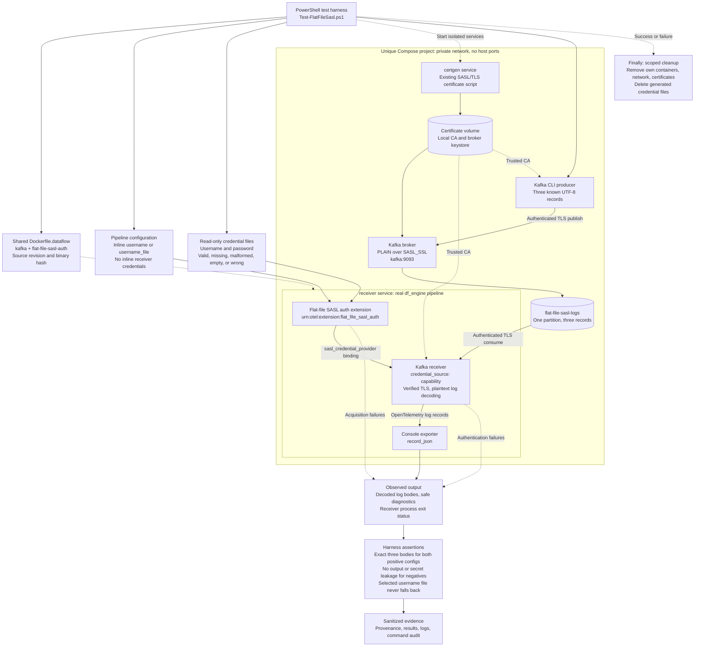

# Flat-file SASL credentials: Kafka receiver E2E

Task [5750616](https://dev.azure.com/msdata/91079a30-3e43-4a67-8253-5ca0050e01e1/_workitems/edit/5750616)
validates **initial acquisition** by the real
`urn:otel:extension:flat_file_sasl_auth` extension and Kafka receiver against
the existing [SASL/TLS example](../sasl-tls/README.md)'s broker.
It does not use a fake credential provider or an older prebuilt engine.

## Test workflow



Solid arrows show build, configuration, credential, and telemetry flow; dashed
arrows show orchestration, trust inputs, and failure observations. The harness
runs each case separately with a fresh consumer group. Positive cases must
deliver the exact expected bodies; negative cases must fail safely without
delivering records. Evidence is retained even when a case fails, and cleanup
is limited to that invocation's resources.

## Run

Prerequisites: PowerShell 7+, Git, Docker with Compose v2/buildx, and the
repository's pinned `proto/opentelemetry-proto` submodule. From the repository
root, initialize that submodule if necessary:

```powershell
git submodule update --init proto/opentelemetry-proto
Set-Location rust\otap-dataflow\examples\kafka\flat-file-sasl
pwsh -NoProfile -File .\scripts\Test-FlatFileSasl.ps1
```

The first engine build can take 10-30+ minutes. The shared
[`Dockerfile.dataflow`](../Dockerfile.dataflow) invokes `cargo build --locked
--release` with `kafka,flat-file-sasl-auth` plus the existing default features.
The target is `x86_64-unknown-linux-gnu`, with
`RUSTFLAGS=-C target-cpu=x86-64`. No production source or dependency changes
are needed.

Each invocation creates a unique `ff-sasl-5750616-*` Compose project, private
network, certificate volume, and Kafka data. No host ports are published.
The broker has a 1.5 GiB memory limit and 512 MiB JVM heap; the receiver and
certificate generator each have 512 MiB limits. Each service is limited to one
CPU. Only resources belonging to that invocation are removed in `finally`.
Existing example stacks and shared containers are not stopped or deleted.

The reused broker image is `confluentinc/cp-kafka:8.3.1`. The tested listener
is **PLAIN over SASL_SSL** at `kafka:9093`, with CA verification enabled.
Kafka's internal plaintext listener remains private and is used only by the
inherited broker healthcheck. Topic creation, production, offset inspection,
and the receiver all use the authenticated TLS listener.

To reuse an image built from the **current HEAD** with the required features:

```powershell
pwsh -NoProfile -File .\scripts\Test-FlatFileSasl.ps1 `
  -SkipBuild -Image otap-flat-file-sasl:<source-revision>
```

The harness rejects images whose source-revision label differs from HEAD.
Use `-SkipBuild` only for an image built using the documented recipe, not an
arbitrary relabeled image. Every run records the actual image ID and SHA-256
of the extracted executable, without assuming a shell exists in distroless.

## Exact configuration shape

The selected source uses **`credential_source: capability`**, not
`credentials: capability`. The node's binding is outside `config`:

```yaml
extensions:
  credentials:
    type: urn:otel:extension:flat_file_sasl_auth
    config:
      username_file: /credentials/username
      password_secret_file: /credentials/password
      password_secret_file_refresh: 1h
      startup_timeout: 3s
nodes:
  kafka:
    type: urn:otel:receiver:kafka
    capabilities:
      sasl_credential_provider: credentials
    config:
      auth:
        sasl:
          mechanism: PLAIN
          credential_source: capability
```

The runnable configs are [`receiver-inline.yaml`](./receiver-inline.yaml)
and [`receiver-files.yaml`](./receiver-files.yaml). Neither puts credentials in
the receiver. The latter deliberately also supplies a valid inline username
to the **extension**: missing, malformed, empty, or broker-rejected selected
username files must never fall back to it.

## Assertions

Kafka's producer writes exactly three unique UTF-8 records to one partition.
The receiver's supported `plaintext` log encoding converts each complete
record into an OpenTelemetry log body. A real console exporter writes
`record_json`. The harness parses those records and compares all three
**exact bodies** against the known input, independently for both positive
configurations using fresh consumer groups. Startup logs, assignment messages,
offsets, or an acquisition-success metric alone cannot pass delivery.

| Case | Required result |
| --- | --- |
| Inline username + password file | Three exact decoded output bodies |
| Username file + password file | Three exact decoded output bodies |
| Missing password file | Nonzero startup exit, password-file diagnostic, no output |
| Invalid UTF-8 password file | Nonzero startup exit, password-file diagnostic, no output |
| CR/LF-only password file | Nonzero startup exit, password-file diagnostic, no output |
| Missing username file + valid inline username | Nonzero startup exit, username-file diagnostic, no fallback output |
| Invalid UTF-8 username file + valid inline username | Nonzero startup exit, username-file diagnostic, no fallback output |
| CR/LF-only username file + valid inline username | Nonzero startup exit, username-file diagnostic, no fallback output |
| Wrong password | Observable SASL authentication rejection, no decoded output |
| Wrong file username + valid inline username | Observable SASL authentication rejection, no fallback output |

Valid files contain trailing CR/LF, exercising the documented trimming.
Malformed files contain invalid UTF-8 after a synthetic disclosure marker.
All receiver logs are checked for the known synthetic passwords, wrong
username, and disclosure marker **before** a case can pass. Saved evidence
redacts these values even on failure. Only public, local-test broker
credentials are used; do not substitute real credentials.

Each case has a 45-second bound (`-CaseTimeoutSeconds`, allowed 15-180).
Provider startup is limited to three seconds. Broker authentication errors
are asynchronous and need not terminate the engine: the harness requires an
explicit SASL rejection plus a further no-output observation window, then
stops that receiver. Docker subprocesses, broker readiness, build, and cleanup
also have explicit bounds. Failures throw; no case is silently skipped.

## Evidence and cleanup

The script prints `.runs\<unique-project>` and saves:

- `provenance.json`: source SHA, image ID, executable SHA-256, feature flags,
  mechanism, transport, and encoding.
- `broker-image.json`: broker image ID and registry digest.
- `expected-bodies.json`, `topic-offsets.log`: exact input and broker count.
- One sanitized receiver log per case, `broker.log`, and `results.json`.
- `commands.json`: Docker argument sequences and exit codes; stdin credential
  properties are intentionally not recorded.
- `cleanup.json`: scoped Compose cleanup outcome.
- `summary.json`: explicit overall outcome, expected/passed case counts, and
  last case even when the script throws.

Generated credentials are removed, and the project's containers, network, and
certificate volume are deleted, including on failure. Logs/results remain in
the ignored `.runs` directory. The reusable engine image and normal Docker
build cache remain. The focused [validation report](./VALIDATION.md) records
the executed run and selected sanitized evidence for review.

Rotation, Azure Key Vault, live consumer recreation/rebalancing, and benchmarks
are out of scope. This development-only validation does not require a
user-facing changelog entry.
